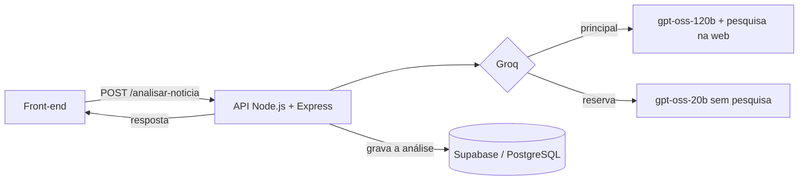

# TruthCheck AI

Plataforma de verificação de notícias com inteligência artificial. Projeto de TCC do curso de Ciência da Computação da Unifran (2026).

O usuário envia o texto (ou o link) de uma notícia e recebe, em segundos, uma avaliação da veracidade com justificativa, nível de confiança e as fontes consultadas.


## O problema

Notícias falsas se espalham mais rápido do que é possível checá-las manualmente. O TruthCheck usa um modelo de linguagem com pesquisa na web para fazer uma primeira checagem rápida, explicando o motivo da classificação e mostrando de onde a informação veio.

## Como funciona



1. O usuário cola o texto ou o link da notícia no front-end.
2. O front-end chama `POST /analisar-noticia` na API.
3. A API consulta o modelo `openai/gpt-oss-120b` na Groq com pesquisa na web. Se ele falhar, usa o `openai/gpt-oss-20b` sem pesquisa (modo reserva).
4. A resposta traz a classificação (selo), a justificativa, o nível de confiança, o modo usado e as fontes.
5. Cada análise é gravada na tabela `analises` do Supabase.

## Tecnologias

| Camada | Tecnologia |
| --- | --- |
| Back-end | Node.js, Express |
| IA | Groq SDK (`openai/gpt-oss-120b` com `browser_search`, `openai/gpt-oss-20b` como reserva) |
| Banco de dados | Supabase (PostgreSQL) |
| Front-end | HTML, CSS e JavaScript (protótipo); React em desenvolvimento |
| Mobile | React Native com Expo (planejado) |

## Funcionalidades

- [x] Classificação da notícia por IA
- [x] Justificativa da classificação
- [x] Nível de confiança e fontes consultadas
- [x] Gravação das análises no Supabase
- [ ] Envio por URL (em testes)
- [ ] Cadastro e login (Supabase Auth)
- [ ] Histórico de análises por usuário
- [ ] Dashboard administrativo com métricas
- [ ] Versão web em React e app mobile em React Native

## Como rodar localmente

Pré-requisitos: Node.js instalado, uma chave da [Groq](https://console.groq.com) e um projeto no [Supabase](https://supabase.com).

```bash
git clone https://github.com/JoaoPedro25fer/TruthCheck-AI.git
cd TruthCheck-AI/backend
npm install
```

Crie o arquivo `backend/.env` a partir do `backend/.env.example`:

```
GROQ_API_KEY=
SUPABASE_URL=
SUPABASE_SECRET_KEY=
```

Inicie a API (porta 3000):

```bash
node server.js
```

Depois abra `frontend/index.html` com a extensão Live Server do VS Code.

## Estrutura

```
TruthCheck-AI/
├── backend/     # API Node.js + Express (server.js)
└── frontend/    # Protótipo da interface (index.html)
```

## Capturas de tela

<!-- Adicione aqui prints da tela de análise ou um GIF do uso -->

## Contato

João Pedro Fernandes — [GitHub](https://github.com/JoaoPedro25fer) · [LinkedIn](https://www.linkedin.com/in/joao-pedro-fernandes-a432b5212)
