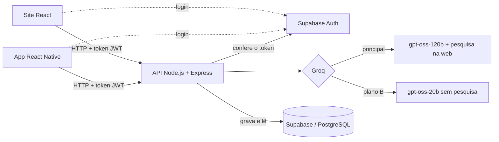

# TruthCheck AI

Plataforma web e mobile de verificação de notícias com inteligência artificial. Trabalho de Conclusão de Curso de Ciência da Computação da Unifran (2026).

O usuário cola o texto ou o link de uma notícia e recebe, em segundos, uma classificação com selo, justificativa, nível de confiança e as fontes consultadas.


## O problema

Notícias falsas se espalham mais rápido do que é possível checá-las manualmente. O TruthCheck usa um modelo de linguagem com pesquisa na web para fazer uma primeira checagem rápida, explicando o motivo da classificação e mostrando de onde a informação veio.

## Os quatro selos

| Selo | Quando é usado |
| --- | --- |
| **Verificado** | A informação é confirmada por evidências confiáveis |
| **Falso** | A informação é contradita por evidências concretas |
| **Enganoso** | Mistura fatos reais com distorções, exageros ou falta de contexto |
| **Inconclusivo** | Não há evidência suficiente para confirmar nem para desmentir |

## Como funciona



1. O usuário cola o texto ou o link da notícia no site ou no app.
2. O cliente chama `POST /analisar-noticia`, levando o token de login, se houver.
3. A API consulta o modelo `openai/gpt-oss-120b` na Groq, com pesquisa na web obrigatória. Se falhar, usa o `openai/gpt-oss-20b` sem pesquisa (plano B).
4. A resposta traz o selo, a justificativa, a confiança, as fontes e o modo usado.
5. A análise é gravada na tabela `analises` do Supabase, ligada ao usuário logado.

Os clientes nunca acessam a tabela nem a IA diretamente: só a API conhece as chaves secretas.

## Funcionalidades

- [x] Cadastro e login (Supabase Auth + JWT)
- [x] Análise por texto ou por link
- [x] Classificação por IA em quatro selos
- [x] Justificativa, nível de confiança e fontes consultadas
- [x] Histórico de análises por usuário
- [x] Painel administrativo com métricas (total, por selo, por modo, confiança média e últimos 14 dias)
- [x] Site em React e app mobile em React Native com Expo

## Tecnologias

| Camada | Tecnologia |
| --- | --- |
| Back-end | Node.js, Express 5 |
| IA | Groq SDK (`openai/gpt-oss-120b` com `browser_search`; `openai/gpt-oss-20b` como reserva) |
| Banco de dados | Supabase (PostgreSQL, com RLS) |
| Autenticação | Supabase Auth + JWT |
| Web | React 19 + Vite |
| Mobile | React Native + Expo (SDK 58) |

## Estrutura

```
TruthCheck-AI/
├── backend/     # API Node.js + Express (server.js)
├── web/         # Site em React + Vite
├── mobile/      # App em React Native + Expo
└── frontend/    # Protótipo inicial em HTML (tag v0.1-prototipo-html)
```

## Como rodar localmente

Pré-requisitos: Node.js, uma chave da [Groq](https://console.groq.com) e um projeto no [Supabase](https://supabase.com).

### 1. Back-end (porta 3000)

```bash
cd backend
npm install
```

Crie o `backend/.env` a partir do `backend/.env.example`:

```
GROQ_API_KEY=
SUPABASE_URL=
SUPABASE_SECRET_KEY=
ADMIN_EMAILS=          # e-mails de administrador, separados por vírgula
```

```bash
node server.js
```

### 2. Site (porta 5173)

```bash
cd web
npm install
```

Crie o `web/.env` a partir do `web/.env.example`:

```
VITE_SUPABASE_URL=
VITE_SUPABASE_PUBLISHABLE_KEY=   # chave pública, nunca a secreta
VITE_API_URL=http://localhost:3000
```

```bash
npm run dev
```

Abra http://localhost:5173.

### 3. App mobile (Expo Go)

```bash
cd mobile
npm install
```

Crie o `mobile/.env` a partir do `mobile/.env.example`:

```
EXPO_PUBLIC_SUPABASE_URL=
EXPO_PUBLIC_SUPABASE_PUBLISHABLE_KEY=
EXPO_PUBLIC_API_URL=http://<IP do PC no Wi-Fi>:3000
```

No celular, "localhost" é o próprio celular. Por isso a URL da API usa o IP do computador na rede (no Windows: `ipconfig | findstr IPv4`). O celular e o PC precisam estar no mesmo Wi-Fi.

```bash
npx expo start
```

Leia o QR code com o app Expo Go.

## API

| Rota | Método | Login | Resposta |
| --- | --- | --- | --- |
| `/analisar-noticia` | POST `{"texto": "..."}` | Opcional | Selo, confiança, justificativa, fontes e modo |
| `/historico` | GET | Obrigatório | Análises do próprio usuário (401 sem login) |
| `/eu` | GET | Obrigatório | `{"admin": true/false}` |
| `/admin/metricas` | GET | Administrador | Métricas do painel (401 sem login, 403 sem permissão) |

O token vai no cabeçalho `Authorization: Bearer <token>`.

## Resultados

- Os sete requisitos funcionais do pré-projeto foram testados no site e no celular em 24/11/2026.
- Teste de precisão com 15 frases de gabarito conhecido: **80%** de acerto exato do selo (12 de 15) e **93%** acertando se a afirmação é confiável ou não (14 de 15).
- A confiança exibida é a autoavaliação da IA, não a taxa de acerto.

## Limitações

- A IA pode errar: o resultado é uma primeira checagem, e o usuário deve conferir as fontes.
- O backend roda localmente; para uso público, precisa ser publicado com HTTPS.
- O projeto gratuito do Supabase pausa após cerca de uma semana sem uso (`node testar-supabase.js` confere se está ativo).

## Autores

- **João Pedro Fernandes** — [GitHub](https://github.com/JoaoPedro25fer) · [LinkedIn](https://www.linkedin.com/in/joao-pedro-fernandes-a432b5212)
- **Luiz Tonny Moura Santos**

Orientador: Prof. Me. Euller da Silva Ferreira · Universidade de Franca (Unifran), 2026.
